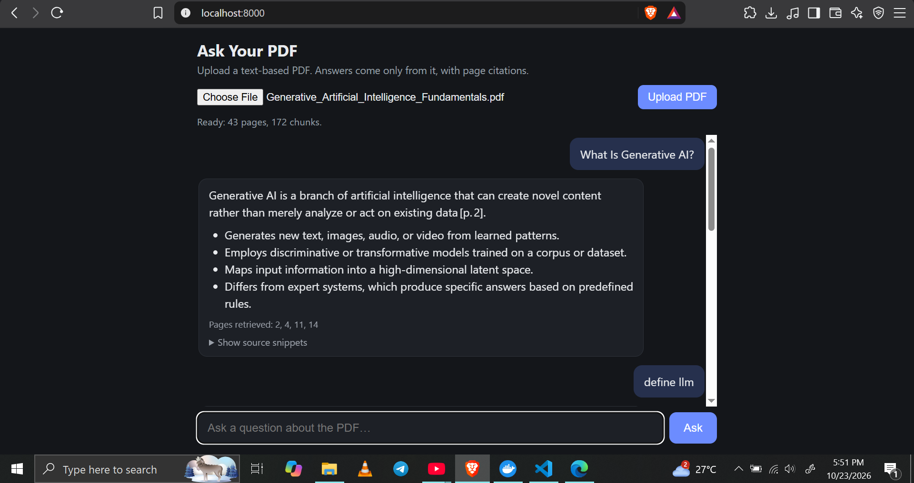

# PDF Assistant: RAG question answering with a measured evaluation

Upload a text-based PDF and ask questions about it. Answers come **only** from the document, cite page numbers, and the app refuses when the document does not cover the question. Retrieval quality is measured with a small evaluation harness instead of being assumed.

**Demo:** _[add a link or a screen recording]_  
**Stack:** FastAPI, LangChain components, Chroma, sentence-transformers, Groq, vanilla HTML/CSS/JS, pytest, Docker



---

## What it does

- Upload a PDF (limits: 50 MB, 400 pages, text-based only) and chat with it.
- Every answer shows the retrieved pages and expandable source snippets, so the user can check the citations.
- Out-of-scope questions return one fixed refusal sentence instead of a guess.
- Each upload gets its own in-memory index, so documents never mix between uploads.
- Answers render as formatted Markdown, sanitized before display.

## Architecture

```
Browser (HTML / CSS / JS)
   |  POST /api/upload (PDF)          POST /api/ask (doc_id + question)
   v
FastAPI (api.py)    validation, error mapping, per-request logging
   v
rag.py
   |- load_chunks   PyPDF -> 1000-character chunks, 150 overlap, 1-based page metadata
   |- build_store   all-MiniLM-L6-v2 embeddings -> in-memory Chroma collection (one per upload)
   |- retrieve      MMR search: 5 results from 20 candidates
   '- generate      Groq LLM, temperature 0, answer only from the retrieved context
```

## Design decisions and why

Settings chosen with evidence are marked **measured**. The rest are marked **not tuned**, because I did not test alternatives.

| Decision | Choice | Reason |
|---|---|---|
| Top-k | 5 (**measured**) | k=8 gave the same recall (18/18) and the same MRR within noise (0.883 vs 0.886), but about 50% more input tokens (1534 vs 1022). On a free tier, tokens are the limit. |
| Embedding model | all-MiniLM-L6-v2 (**measured**) | bge-small-en-v1.5 scored lower on my question set (recall 16/18, MRR 0.775 vs 0.886) and indexed roughly twice as slowly. I did not test bge's optional query prefix, so this means "did not beat MiniLM in my setup", not "bge is worse". |
| Retrieval | MMR (**not tuned**) | Books repeat ideas across chapters, and MMR avoids returning near-duplicate chunks. `lambda_mult=0.5` was not tuned on the final question set. |
| Chunk size | 1000 characters, 150 overlap (**not tuned**) | A starting point of a few paragraphs, close to MiniLM's roughly 256-token input limit. |
| LLM | `openai/gpt-oss-20b` on Groq | Free tier and fast. Not benchmarked against other models. The model name lives in `.env` because providers retire models. |
| Temperature | 0 | Repeatable behavior, which evaluation needs. Small variation can remain. |
| Index per upload, in memory | Chroma, no persistence | Prevents one upload's questions from retrieving another document. The cost is that indexes disappear on restart. |
| Prompt | "Answer ONLY from the context", an exact refusal sentence, no "implied" points | An early answer padded in points the book only implied. The prompt now forbids that. |

## Evaluation

**Method.** 22 questions I wrote myself: 18 answerable with the correct PDF pages labeled, and 4 unanswerable. I found the labels with plain text search, independently of the retriever. The harness (`evals/run_eval.py`) measures retrieval without calling the LLM, then checks refusals with the LLM.

The test document was _Designing Machine Learning Systems_. It is a copyrighted book, so it is **not included** in this repository.

- **Recall@k:** did any retrieved chunk come from a correct page?
- **MRR:** how early did the first correct page appear?
- **Refusal:** did the bot refuse the unanswerable questions?

| Run | Change | Recall | MRR | Avg input tokens | Index time |
|---|---|---|---|---|---|
| baseline2 | k=5, MiniLM | 18/18 | 0.886 | 1022 | about 110 s |
| k8 | k=8, fetch_k=30 | 18/18 | 0.883 | 1534 | about 117 s |
| bge-small | bge-small, k=5 | 16/18 | 0.775 | 1048 | about 218 s |

Refusals were correct on 4/4 in every run. Index times came from a dual-core laptop CPU and varied between runs, so treat them as rough.

**Where the baseline fails.** Recall is saturated, so MRR is the useful number. The correct page ranked first for 15 of 18 questions. For q10 (shadow vs canary) the table of contents ranked first and the right page second. For q19 (few labels) the right page was fourth. For q18 (detecting shift) it was fifth: the question used plain words while the book says "two-sample test".

**A bug in my own evaluation.** My first question set scored 0/9. Two different embedding models failed in the same way, which pointed at the test and not the models. My page labels used the book's printed page numbers, which were 20 behind the PDF's page positions. I confirmed the offset against the book's own index, fixed the labels, and the baseline reached 12/12. That was too easy because the labels were wide and the questions reused the book's wording, so I tightened the labels and added paraphrased questions. The full story is in `DECISIONS.md`.

**Limits of this evaluation.**
- 18 answerable questions is small. One question is about 5.5 percentage points, so a one-question difference is noise.
- Some labels cover several pages, which makes a hit easier.
- I labeled the questions myself.
- It measures retrieval and refusal, not the quality of the generated answers.

## Reliability and security

- **Upload checks:** `.pdf` extension, `%PDF` signature, 50 MB size cap, 400-page cap, and a clear error for scanned PDFs with no text layer.
- **Safe rendering:** model output is parsed with `marked` and sanitized with DOMPurify, so HTML or scripts injected through a PDF or an answer cannot run.
- **Error mapping:** provider rate limits, connection failures and API errors become clear 429, 503 and 502 responses, and the UI stays usable.
- **Logging:** each request logs retrieval time, LLM time and token counts. Question text is not logged.
- **No tools:** the bot cannot act on anything, so a malicious PDF can only influence the text of an answer. The prompt reduces, but does not eliminate, prompt-injection risk.
- **Privacy:** uploaded text is sent to a third-party free API. Do not upload sensitive documents.
- **Tests:** 11 pytest tests cover upload validation, request validation, error mapping and the refusal contract. Retrieval and the LLM are mocked, so they test the application code. Answer quality is covered by the evaluation harness, not by these tests.

## Run it

```bash
python -m venv .venv
.venv\Scripts\activate          # Windows. On macOS/Linux: source .venv/bin/activate
python -m pip install -r requirements-dev.txt
```

Create a `.env` file with **no spaces around `=` and no quotes** (Docker's env-file parser rejects spaces):

```
GROQ_API_KEY=your_key_here
GROQ_MODEL=openai/gpt-oss-20b
```

Check the model name against the models your Groq key can use, since Groq retires models often.

```bash
python -m uvicorn api:app
```

Open http://127.0.0.1:8000. Interactive API docs are at `/docs`.

### Docker

```bash
docker build -t pdf-qa .
docker run --rm --env-file .env -p 8000:8000 pdf-qa
```

The image uses Python 3.12, CPU-only PyTorch, and downloads the embedding model at build time. I built it and ran it locally with an upload and a question. There is no CI pipeline yet.

### Tests

```bash
python -m pytest -v
```

### Evaluation

```bash
python -m evals.run_eval --pdf your.pdf --label baseline
python -m evals.run_eval --pdf your.pdf --label k8 --k 8 --fetch-k 30
```

Every run appends a line to `evals/results.jsonl`. `evals/questions.json` holds the questions and the labeled pages, and it is specific to the book above. To evaluate another document, write your own questions and labels first, before looking at what the retriever returns.

## API

| Endpoint | Request | Response |
|---|---|---|
| `POST /api/upload` | multipart form with `file` | `{doc_id, pages, chunks}` |
| `POST /api/ask` | `{doc_id, question}` (question up to 500 characters) | `{answer, pages, sources}` |

## Project structure

```
api.py             FastAPI app: upload, ask, validation, logging, static files
rag.py             chunking, embeddings, retrieval, generation, prompt
static/            index.html, style.css, app.js
evals/             run_eval.py, questions.json, results.jsonl
tools/             helper scripts used to build the evaluation set
tests/             pytest tests (retrieval and LLM mocked)
Dockerfile         Python 3.12, CPU-only torch, model baked in
requirements.txt   direct dependencies
DECISIONS.md       log of experiments, failures and decisions
```

## Limitations

- Text-based PDFs only. There is no OCR, and tables or multi-column layouts may extract poorly.
- The index lives in memory: lost on restart, no user accounts, no rate limiting, and not hardened for public hosting.
- No conversation memory. Each question is answered on its own, so follow-ups like "what about its cost?" can fail.
- The headline numbers come from a copyrighted book I cannot share, so others cannot reproduce them exactly.
- The evaluation set is small and labeled by me.
- Chunk size, overlap, MMR lambda and the LLM choice were not tuned.

## Future work

- Skip the table of contents and index when indexing, since they took retrieval slots in several questions.
- Test a cross-encoder reranker against the MRR failures above.
- Tune chunk size and overlap with the same harness.
- Add query rewriting so follow-up questions work.
- Re-run the evaluation on a freely licensed document so results are reproducible.
- Index large uploads in the background with a progress bar.
- Replace the deprecated `langchain-community` PDF loader.
- Add CI to run the tests and the Docker build on every push.

## What I learned

_Write 3 or 4 sentences in your own words: the page-offset bug and how you found it, why MRR told you more than recall, and what you would change first._